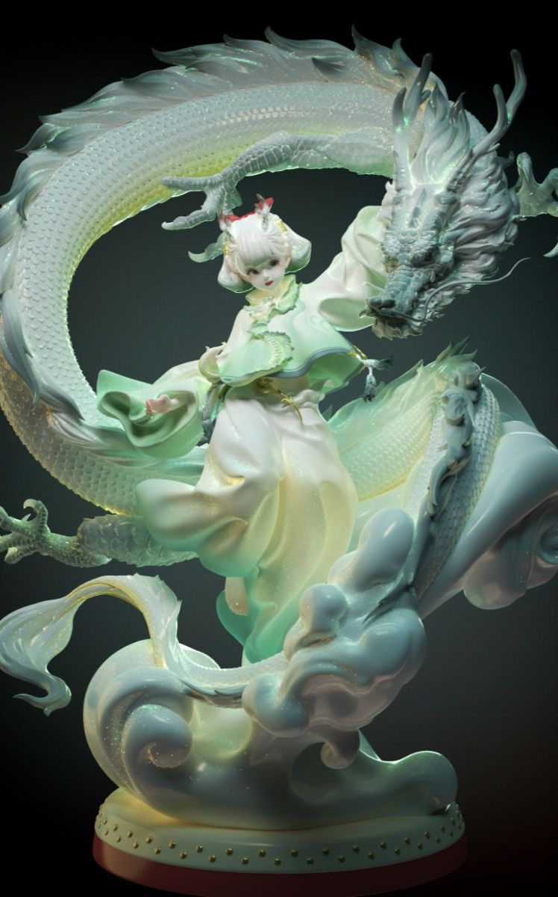
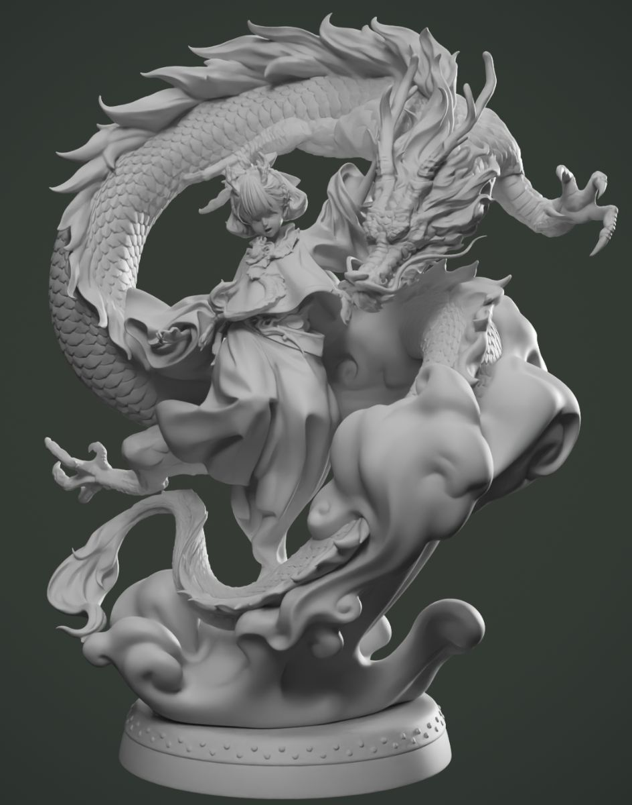
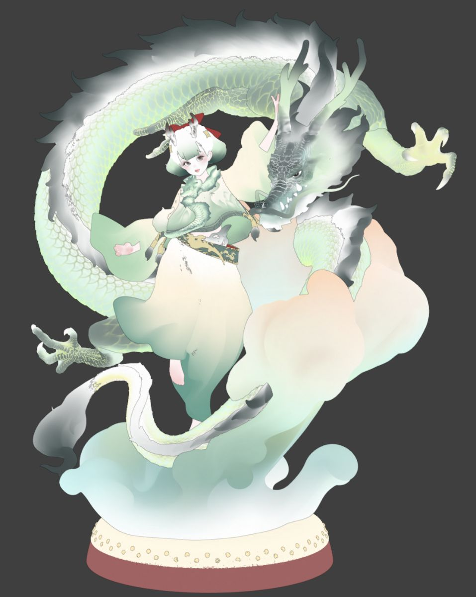
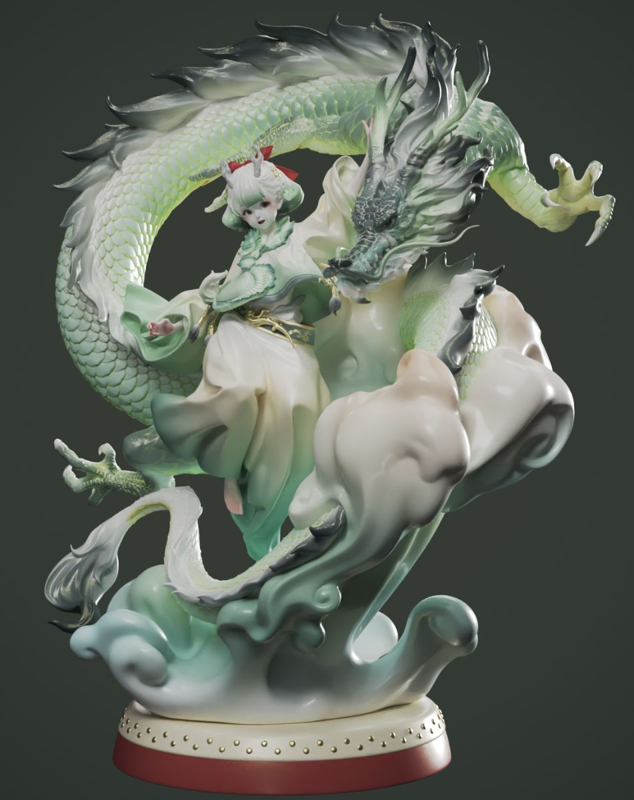

## 我几乎不会特意去参加行业比赛。面对命题创作、还有有时间限制的项目，我总会觉得吃力，很难放松下来进入状态。之前两届 GGAC，本来打算试试看，文件夹都建好了，可一直找不到灵感，最后就不了了之。

还有第十一届世界渲染大赛，当时已经做了一部分内容，但时间没规划好，前期设计特别仓促。加上我有点强迫症，所有资源都想纯手搓，耗费了很多时间，成品达不到自己预期，只能放弃。也算是认清了，我暂时还适应不了比赛这种高强度创作节奏。

做都做了还是在这里低调发发吧，名字叫“一跃长大”

大概传达的意思是关于“犬子”的换位守护，跳跃过程预想是很酷炫的“阻碍”被冲破

《龙》这个作品就赶巧，那段时间刚好在做同类型题材，做完之后抱着试一试的心态投了稿，没想到有幸拿到特等奖。非常感谢各位大佬的认可～

**这是由-CG模型网—7.GAME—集美殿堂-以及行业各路大咖合力举办的“模点奖”东方潮玩雕像创意大赛**

[**点击此处进入赛事页面**](https://www.cgmodel.com/activity/award2023.html)

接下来就说说这个作品的一些设计制作过程

创作的时候正好是龙年春节，我想做一张轻松欢快的龙主题练习稿。最开始画草图，想法大概是一个跃动的少女，单手举着龙头挥舞。

之后就在 Blender 里起稿，搭建立体造型、慢慢补细节。原本设想的是像现实舞龙那样，让少女挥舞龙头，但试完发现，挥舞这么一个完整具象的龙头看着很别扭。于是改成少女轻抚龙头，让人和龙变成平等相伴的感觉。

接着我反复尝试人物不同的感觉，换各种发型、服装。那时候人物完整形象还没有想好，在这块琢磨了挺久。

就在这个阶段，我看到 CGMODEL 这个国风文物主题比赛，一下子就想到了 “玉龙”。但画面整体造型已经定下来了，要怎么贴合主题呢？我就把 “玉龙” 拆成两个元素：“玉” 和 “龙”。玉的色彩质感，加上龙这个主题，刚好都是我很喜欢的。

之后我就把重心放在色彩和材质上面。虽然外形和文物原型没什么关联，但我希望从整体气质和氛围上，传递出新的感受。刚好春天来了，也给画面赋予春意盎然、生机勃勃的感觉。

最后在基础颜色、材质、灯光、后期的修饰下， 完成了这张图并提交参赛。

严格来说这张图只能算是概念图。建模的时候为了快速验证最终效果，我会把色彩、材质、灯光还有后期同步一起调整，没有把各个创作环节拆分开。

渲染图里原始模型的颜色其实就像上图这样，大部分都是白色。最终画面的效果，都是靠灯光加后期调出来的。只有看到最终画面，我才能感知到哪里需要修改，体会作品整体的氛围感。我一直习惯看着最终效果推进设计，就像手绘画画一样。

虽然是在观察最终效果的情况下去制作，但也不会茫然地去调整每个技术环节， 我清楚色彩、材质、灯光、后期每一层起到的作用和互相带来的影响，就像合成一样，所有调整都是为画面服务。如果搞不懂每一层会怎么影响画面，很容易越调越乱。

后来考虑实体化的时候，我又整体修整了一遍。把构图做得更紧凑，修改了一些外形，同时梳理拆件结构、支撑这类实物制作相关的问题。

色彩参考了概念图的色调重新设定，更多要考虑实物喷涂能不能实现。

这就是最后在最简单的材质和灯光环境下的效果，也就是尽量靠近实物能够呈现的效果。

这就是在最简单的材质灯光环境下呈现的效果，尽量贴近实物最终能做出来的样子。

整个创作过程对我来说，是很轻松、很享受的。作品没有承载很沉重的表达或者深远的含义，本身想传递的就是轻松愉悦的氛围。而且这件作品带给我好多人生里的 “第一次”：第一次获奖，第一次站在台上紧张得哆哆嗦嗦地说感谢，第一次骑共享单车绕着天安门蹬了三圈……

虽然颁奖典礼是 7 月底，但我总觉得，属于这个作品的春天感，延续了好久……

