我几乎没有特意参加行业比赛，觉得自己对命题性创作，还有一定时间要求的，会感到比较吃力，很难放松的进入状态。之前GGAC的比赛有两届准备尝试一下来着，文件夹都已经建好了，但是久久没有找到灵感，也就不了了之了。

还有第十一届世界渲染大赛，我已经做了一些，但是时间没有计划好，前期设计阶段非常仓促，加上自己希望所有资源纯手搓（强迫症），消耗了很多时间，最后作品也没有达到满意的状态，也就放弃了，确实自己还没办法适应比赛的创作节奏。

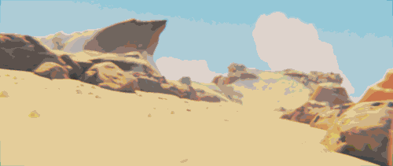

做都做了还是在这里低调发发吧，名字叫“一跃长大”

大概传达的意思是关于“犬子”的换位守护，跳跃过程预想是很酷炫的“阻碍”被冲破

对于《龙》这个作品，也是碰巧那段时间自己在做同类型的题材，于是在作品完成后抱着试试的心态提交了作品，最终有幸收获了特等奖。感谢各位大佬对我的认可~

**这是由-CG模型网—7.GAME—集美殿堂-以及行业各路大咖合力举办的“模点奖”东方潮玩雕像创意大赛**

[**点击此处进入赛事页面**](https://www.cgmodel.com/activity/award2023.html)

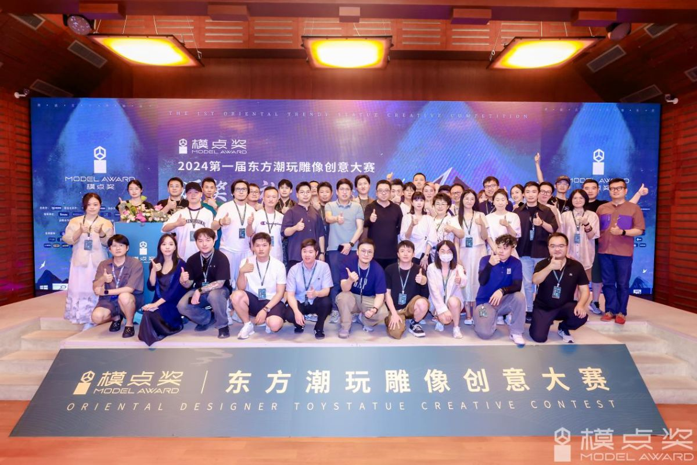

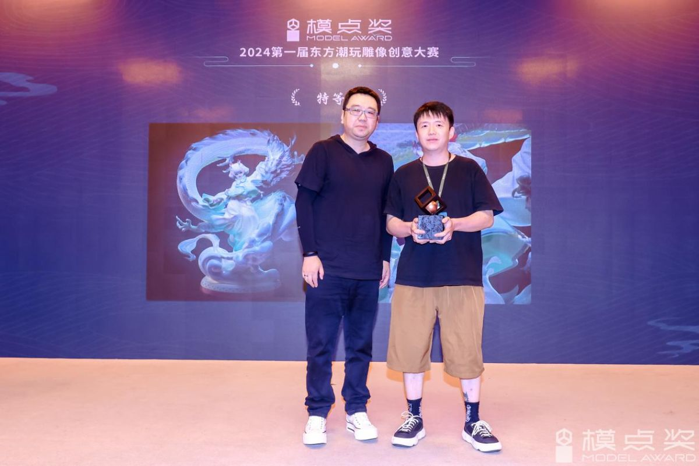

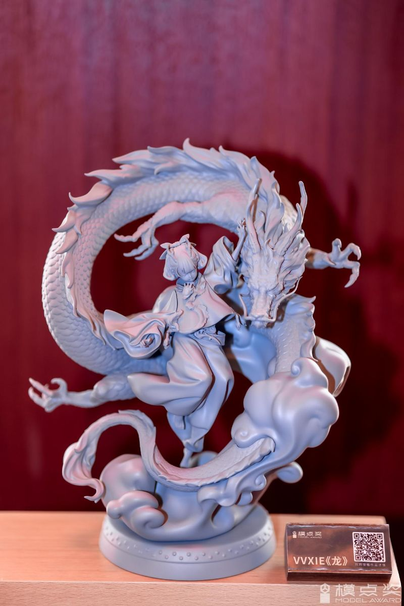

接下来就说说这个作品的一些设计制作过程

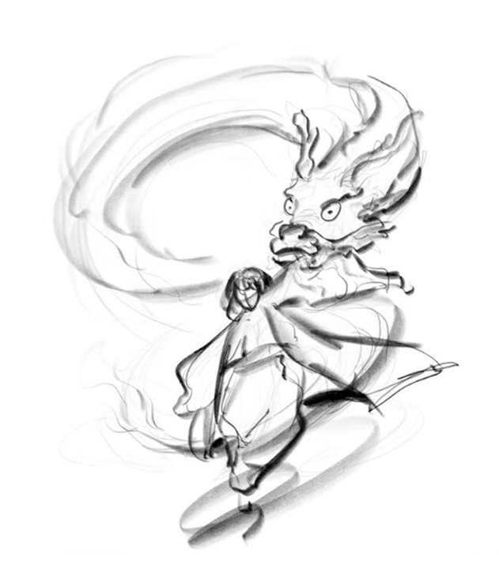

当时正是龙年春节，我希望做一个以龙为主题，且轻松欢快氛围的作品练习，初步画了一个想法，大致就是以少女跃动姿态，单手举着龙头挥舞的的造型。

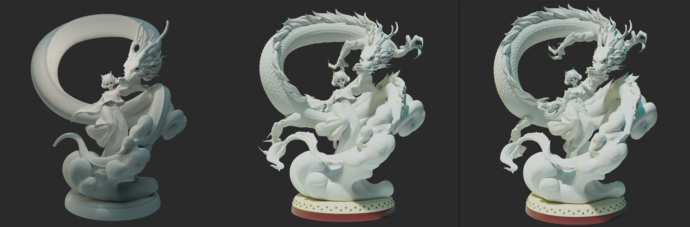

接下来在Blender中开始起稿，完善立体造型和一些细节完善。预想的是举着龙头挥舞，就像现实中舞龙的那样，可是发现要挥舞这么具体的龙太奇怪了，所以将互动变成了轻抚着龙头，将两者关系平化。

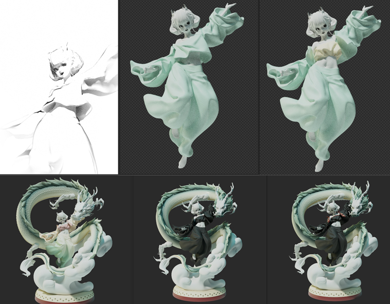

然后开始对人物的不同感觉进行尝试，不同的发型服装等等。这个时候对人物整体还没有完整的想象，就在这个上面花了些功夫。

这时候我才看到CGMODEL有这样的国风文物主题比赛，于是我马上想到了“玉龙”，但是整体造型都已经定好了，如何才能更贴合主题呢，所以我把字给拆成了两个元素“玉”和“龙”，玉的色彩和质感，还有龙的主题，刚好都是我喜爱的元素。

接下来我就在颜色和材质上下功夫，虽然外形上和文物没什么关系，但我希望能在整体气质氛围上去传达一种新的感受。正好春天也到了，增加了春意盎然，生机勃勃的寓意。

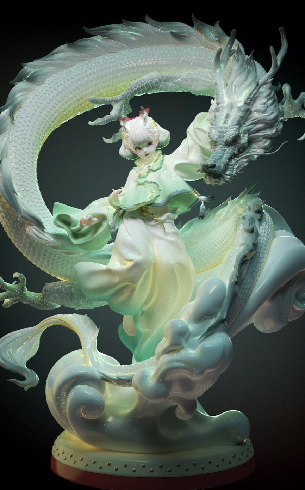

最后在基础颜色、材质、灯光、后期的修饰下，完成了这张图并提交了。

其实这张图只能算作概念图，因为我在模型过程中，需要去快速验证最终效果，所以颜色材质灯光加上后期，都是一起调整的，没有将每个环节流程分开。

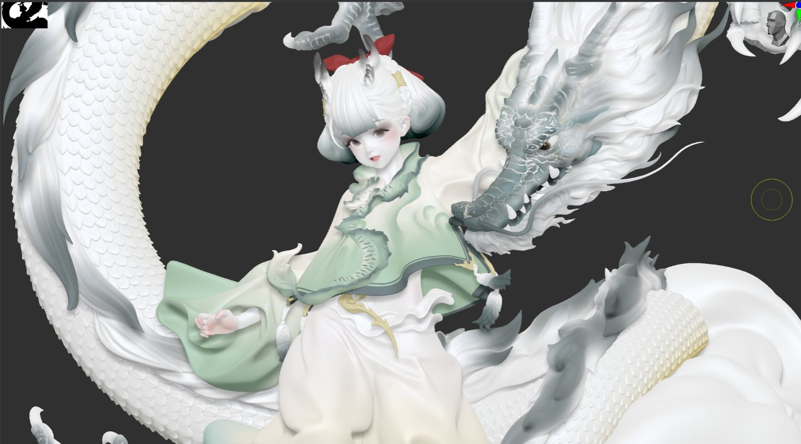

渲染图里的真实模型颜色其实是上图这样的，大部分都是白色。是通过灯光+后期才能达到那个效果。只有在最终画面里，我才能感受到需要调整哪里，还有作品整体传达的氛围感，我也一直习惯了看着最终效果来进行设计，就像完成一幅画一样。

虽然是在观察最终效果的情况下去制作，但也不会混乱的去调整每个技术环节，我清楚知道颜色、材质、灯光、后期的每一层所承担的作用及影响，就像后期合成那样，为画面服务。如果不清楚每一层对画面的影响，就会越调越混乱。

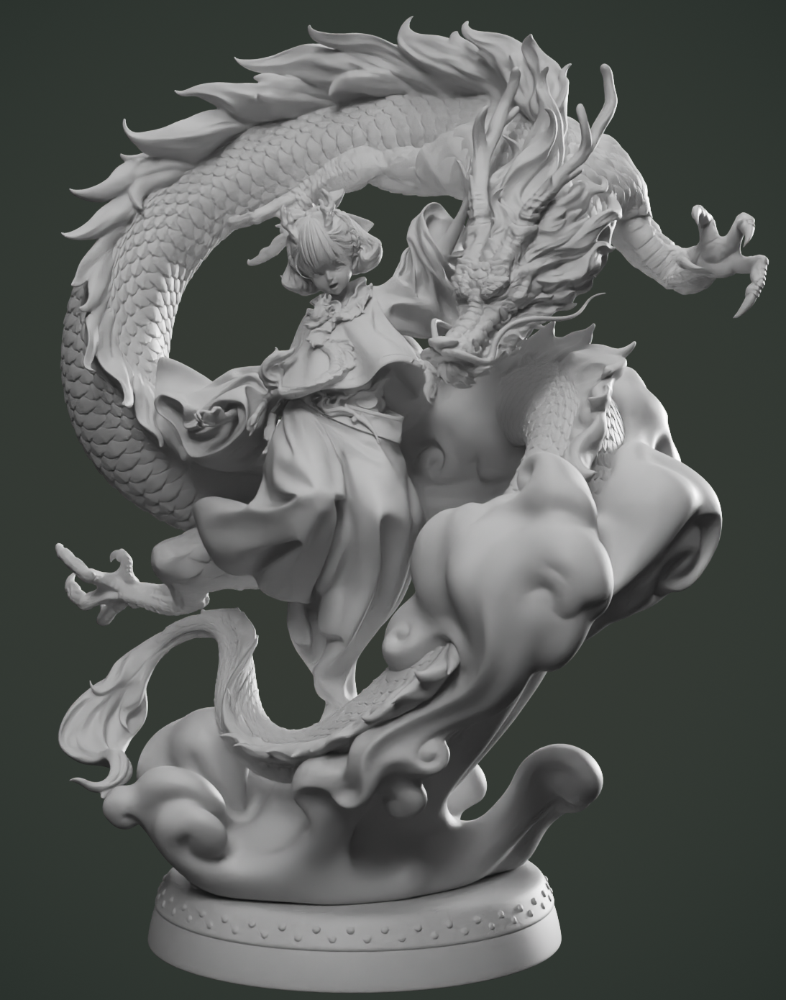

到了后面进行实体化考虑的时候，我又对整体进行了修整。构成上更加紧凑了，修了一些外型。也对拆件结构、支撑等问题进行了梳理。

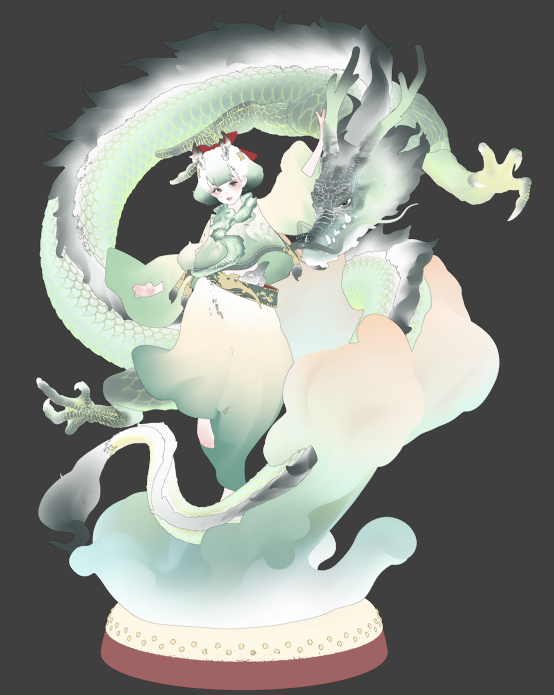

颜色上参考了“概念图”的色彩感进行重新指定，更多就需要考虑实物喷涂的实现度了。

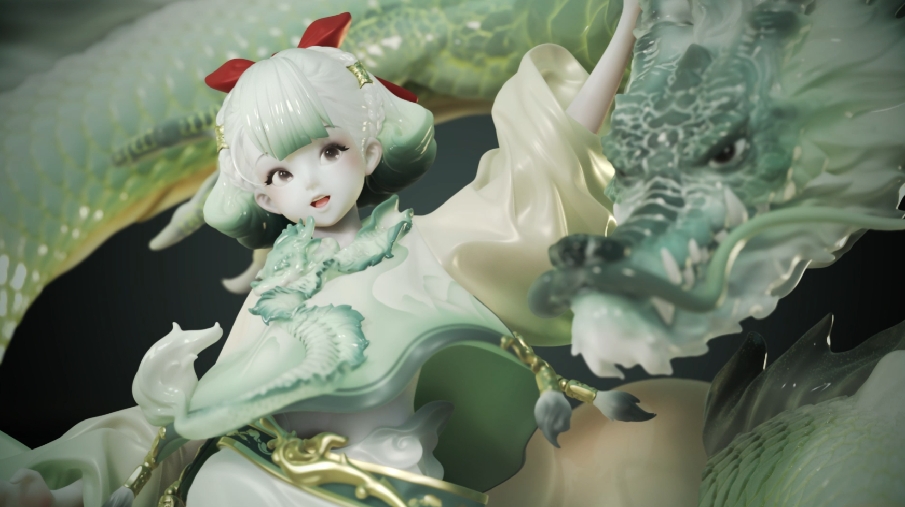

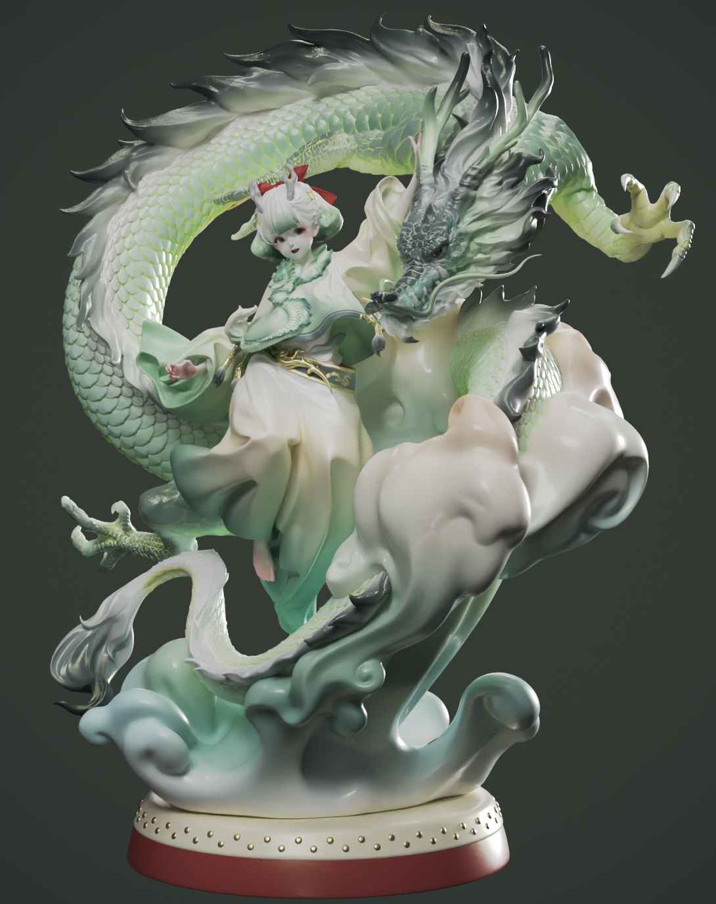

这就是最后在最简单的材质和灯光环境下的效果，也就是尽量靠近实物能够呈现的效果。

这个作品整体过程带给我的感受是非常轻松和享受的，内容上没有过多沉重的表达和深意，作品本身传达的也是轻松愉悦的氛围。再加上这个作品给我带来了很多“第一次”，第一次获奖，第一次登上讲台哆哆嗦嗦说着感谢的话，第一次骑着共享单车绕天安门蹬了三圈。

虽然是到7月底颁的奖，但是我总觉得这个作品的春天感，延续了很久……

