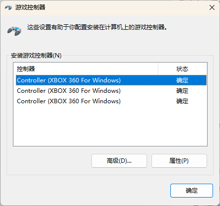

**V_Drone_GamePad_v3.9.4**

**
**

**链接: **[**https://pan.baidu.com/s/1CbsgZv0FPGrjRH2AflXSow?pwd=z383**](https://pan.baidu.com/s/1CbsgZv0FPGrjRH2AflXSow?pwd=z383) **提取码: z383**

每次完成作品想要展示的时候，都觉得做镜头动画好麻烦，又觉得鼠标手摇镜头差点意思。

要是有像无人机那样可以顺滑的镜头就好了，还能练习下无人机操作，在场景中制作各种障碍。

看到有类似的插件，不过是要收费，而且不一定是合适自己需求的。

我的主要目的还是简单的镜头操作来展示作品为主。

于是在deepseek老师花了十亿tok的情况下，磨出了这个可以通过自定义配置操作运动的插件。

首先~你需要一个手柄，我是基于普通PC手柄来做的，是XYAB键的，或者是Xbox键位布局的，应该都可以。

你可以先看看手柄是否支持，

插上手柄后，WIN+R调出运行栏，输入“joy.cpl”就可以看到游戏控制器列表。

现在插件内置了三种操作模式，

**#-Freecam**

类似UE的漫游模式和3D游戏中的操作方式，左摇杆是移动，右摇杆是视角，LT/RT是高度升降。

**#-Position Drone**

这个就是大疆无人机，LT/RT是镜头俯仰

**#-Simple Aircraft**

这个差不多就是GTA里面开固定翼飞机的模式了。

以下是deepseek老师整理的功能说明……

V_Drone_GamePad简介：

用手柄摇杆直接控制机身与镜头的移动、旋转，像操控无人机一样摆机位、拍运镜。适合产品展示、漫游镜头、机械 / 无人机类动画的快速打点。 
 
支持环境 
Blender 3.0 及以上，Windows 
Xbox 系手柄（XInput，Windows 自带，即插即用，无需装驱动） 
纯内置实现，不依赖第三方库；空闲时几乎不占 CPU，也不会持续重绘视图 
操控方式 
左摇杆 左右：机身转向（世界轴） 
左摇杆 上下：机身升降 
右摇杆：机身前后 / 左右平移 
LT / RT：镜头俯仰 / 翻滚（模拟量，推多少转多少） 
具体绑定随预设不同，也可在面板里逐通道改 
不建无人机也能用：解除绑定后，直接操控当前选中的物体

固定按键 
方向键 ↑ / ↓：移动速度倍率 ×1.25 / ÷1.25 
方向键 ← / →：旋转倍率 ÷1.25 / ×1.25 
A：镜头水平回中｜双击 A：机身水平回中 
B：LT/RT 切换到另一组绑定 
X：自动关键帧开关｜Y：时间轴播放 / 暂停 
LB / RB：上一个 / 下一个预设

手感设置 
8 个输入通道（双摇杆、LT、RT，以及 LT/RT 的切换组），可绑定到 15 种运动轴：机身平移 6 种、机身旋转 6 种、镜头局部旋转 3 种 
每个通道独立「反向」与「死区」，越过死区重新映射，不会突跳 
响应曲线：S 形平滑 / 线性 / 指数柔和 / 指数强烈 / 敏捷 / 自定义指数 
防抖滤波；移动、旋转倍率 0.01×–100× 
镜头俯仰限位 0°–180°，接近极限自动减速 
回中为 1 秒平滑过渡，也可「自定回中」记录任意基准姿态

预设 
内置：#-Freecam、#-Position Drone、#-Simple Aircraft 
面板内可保存 / 删除自定义预设（JSON，存放在插件目录 presets/） 
打开工程后沿用保存的预设；还没选过预设时自动用 Freecam

安装与上手 
安装：把 V_Drone_GamePad 文件夹放进 Blender 的 scripts/addons，或在偏好设置里「从磁盘安装」 
启用：偏好设置 → 插件 → 勾选 V Drone GamePad 
使用：3D 视图侧栏 → V Drone → 「创建镜头」→ 勾选「启用无人机」

